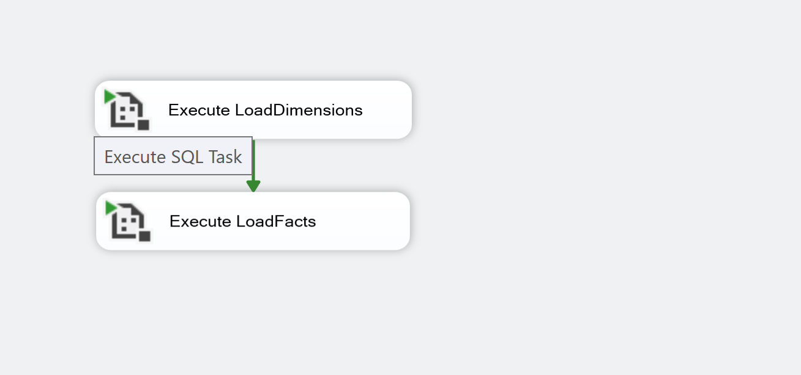
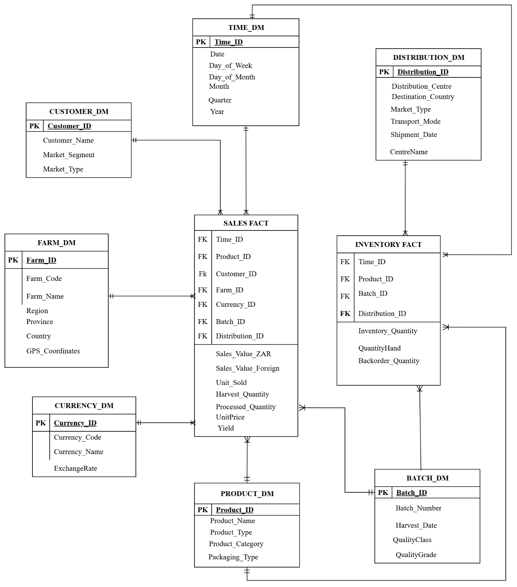

# RooiTea Data Warehouse · SSIS ETL

An SSIS (SQL Server Integration Services) ETL project that consolidates three operational databases of a rooibos tea business into one star-schema data warehouse, `RooiTeaDW`.

**Honours module: Data Warehousing · University of the Free State · SQL Server · SSIS**

## Business scenario
A rooibos tea company keeps its data in separate systems: farming and harvest, sales and orders, and distribution and shipping. Reporting across them (for example, quality grade against destination market) needs one integrated warehouse.

## Architecture
```
 RooiTea_Farming ─┐
 RooiTea_Sales ───┼─►  LoadDimensions  ─►  LoadFacts  ─►  RooiTeaDW
 RooiTea_Distribution ┤       (16 dimension loads)   (fact tables)
 ExchangeRates.csv ───┘
```
`MasterPackage` runs `LoadDimensions` first, then `LoadFacts`, through a precedence constraint, so dimensions and their keys exist before any fact row is loaded.



| Source | Content |
|---|---|
| `RooiTea_Farming` | Farms, harvest batches, processing runs |
| `RooiTea_Sales` | Customers, order headers, order lines |
| `RooiTea_Distribution` | Shipments and destination countries |
| `ExchangeRates.csv` | Flat file of currency exchange rates |

## Design
The warehouse design (measures, hierarchies and a fact-constellation model with Sales and Inventory facts) is documented in [`docs/DESIGN.md`](docs/DESIGN.md).



## What the dimension load does
`LoadDimensions` first clears the warehouse in a safe order (constraints disabled, tables emptied, constraints re-enabled), then loads **16 dimensions** in chained data flows, parents before children:

Date · Country · Province · Region · Farm · Product Category · Product Type · Product · Quality Class · Quality Grade · Market Type · Destination Country · Market Segment · Customer · Currency · Exchange Rate

Techniques used:
- **Lookups** resolve parent surrogate keys for hierarchies, for example Region → Province and Product Type → Product Category.
- **Sort + Union All** merges distinct countries from the customer and shipment sources into one conformed country dimension.
- **Derived columns** build business codes and a full **date dimension** (date key `yyyymmdd`, quarter, month name, financial-year label starting in March).
- **Data conversion** aligns source types with warehouse types.
- A **flat-file source** loads exchange rates alongside the database sources.

## Status
- Design: complete (information package and dimensional model, see `docs/DESIGN.md`).
- Dimension loading: implemented (16 data flows).
- Fact loading: not yet implemented. `LoadFacts.dtsx` is an empty package that `MasterPackage` already calls after the dimensions, so the orchestration is ready for the fact data flows.
- `DimDistributionCentre` and `DimBatch` are cleared by the reset step but have no load flow yet.

## Possible improvements
- Business codes use `UPPER(LEFT(name, 3))`, which can collide for names that share their first three letters. Source IDs would be safer.
- The warehouse is fully cleared and reloaded each run. An incremental load with change tracking would scale better.
- Add a data-quality step that logs rejected rows.

## Repository contents
| Path | Description |
|---|---|
| `packages/MasterPackage.dtsx` | Orchestrates the run |
| `packages/LoadDimensions.dtsx` | The 16 dimension data flows |
| `packages/LoadFacts.dtsx` | Fact load package (empty placeholder) |
| `packages/*.conmgr` | Connection managers (Windows authentication, no passwords) |
| `docs/DESIGN.md` | Measures, hierarchies and schema justification |
| `docs/` | Dimensional model and control-flow screenshots |

To run it you need SQL Server with the four source/target databases and Visual Studio with the SQL Server Integration Services extension.

## Author
Ultimate Ngobeni · [Portfolio](https://ultimate-portfolio-six.vercel.app) · [LinkedIn](https://www.linkedin.com/in/ultimate-ngobeni-156b1a224/)
